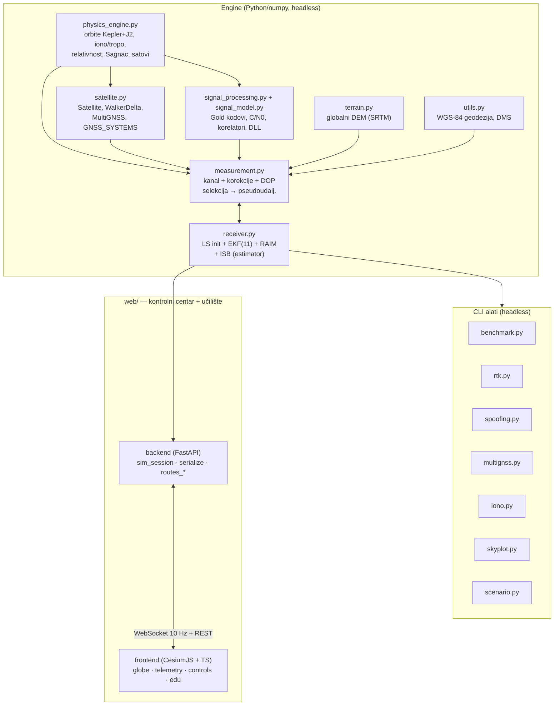
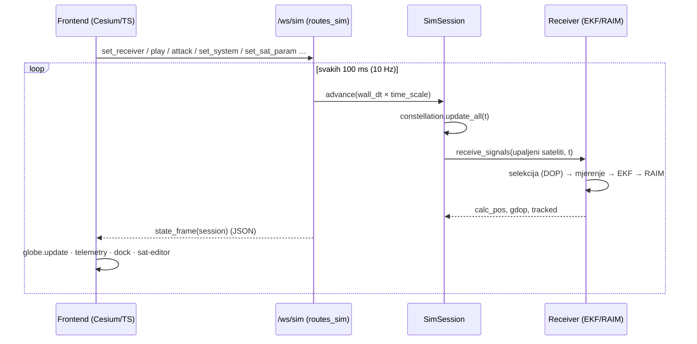
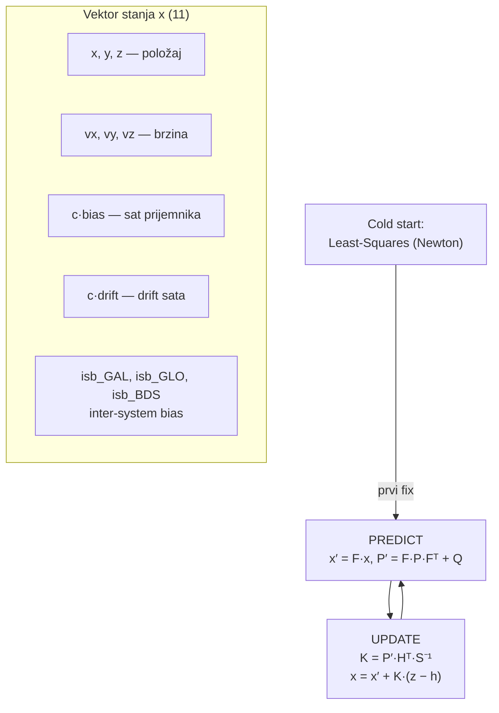
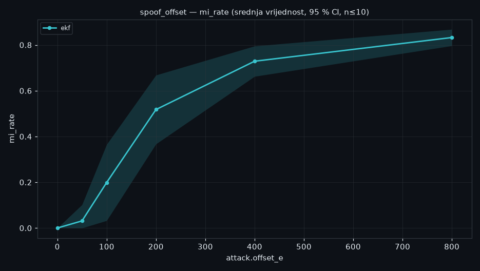
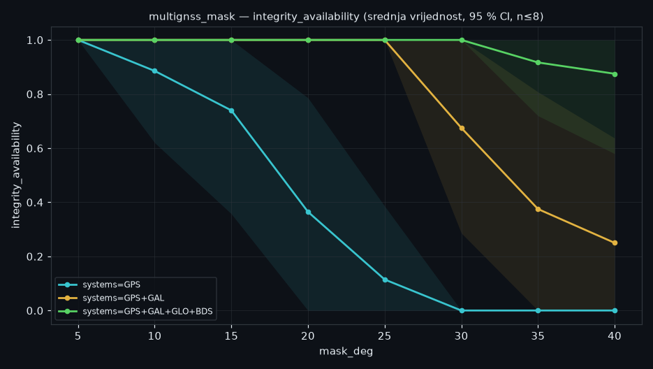
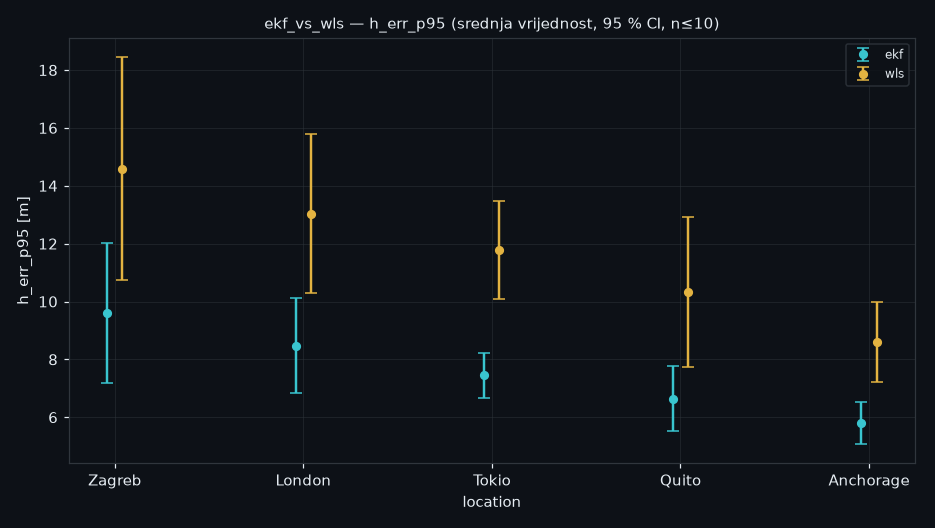

# GPS Simulator 3D — Tehnička dokumentacija i osvrt

Detaljan pregled arhitekture, algoritama, fizičkih modela i inženjerskih odluka
u **GPS Simulatoru 3D**. Projekt je narastao iz geometrijskog kalkulatora u
visokofidelitetni GNSS simulator s **pravim** navigacijskim solverom (EKF + RAIM
+ iono-free + inter-system bias) i modernim web učilištem.

> Za pokretanje, instalaciju i CLI alate vidi [`README.md`](README.md) i
> [`web/README.md`](web/README.md). Ovaj dokument opisuje **kako stvari rade
> iznutra** — i pošteno kaže što je stvarno, a što pojednostavljeno.

---

## 1. Što je ovo (i što nije)

Dvije razine, isti numpy engine:

- **Engine (headless)** — čisti Python/numpy: konstelacije, orbite, fizika
  kanala, obrada signala i navigacijski procesor. Radi bez GPU-a, testira se na
  CI-ju, pogoni sve CLI alate (`benchmark`, `rtk`, `spoofing`, `multignss`…).
- **Sučelje** — **`web/`** kontrolni centar + GPS učilište (FastAPI + CesiumJS),
  dvojezično HR/EN, živa simulacija preko WebSocketa, interaktivni 3D globus.
  *(Raniji desktop `main.py` (PyVista/VTK) je uklonjen — vidi §19.3; web ga u
  potpunosti nadmašuje, a bio je neodržavan i netestiran.)*

**Ključna poanta:** sve iznad simulacije *signala* je autentično. Navigacijski
solver je pravi GNSS algoritam — isti kakav bi radio i na stvarnim mjerenjima
(vidi §8).

Tehnologije: Python 3.11–3.14 · numpy · FastAPI · uvicorn · CesiumJS ·
TypeScript (vanilla, bez frameworka) · Vite · matplotlib (headless grafovi).

Opseg (grubo): engine ~3.400 linija Pythona, web ~3.800 linija TypeScripta +
~600 linija backend Pythona, 117 testova, CI na Pythonu 3.11–3.13.

---

## 2. Arhitektura

### Inventar modula (engine)

| Modul | Linija | Uloga |
|-------|-------:|-------|
| `physics_engine.py` | 272 | Keplerove orbite + J2, Klobuchar ionosfera, Hopfield troposfera, Sagnac, relativistički driftovi, Allanov model sata, sporo-promjenjiva (OU) ephemeris greška |
| `satellite.py` | 183 | `Satellite` (orbita + sat + PRN + ephemeris stanje), `WalkerDeltaConstellation` (GPS 24/6/1), `MultiGNSSConstellation` (GPS/GAL/GLO/BDS, 96 sat.), `GNSS_SYSTEMS` (parametri + ISB) |
| `signal_processing.py` | 262 | **Pravi C/A Gold kodovi** (LFSR-i), dijeljena geometrija multipatha; referentni FFT RF kanal (8× naduzorkovanje) — više nije u živom lancu (§5.1) |
| `signal_model.py` | ~330 | **Signalni model** (§5.1): link budget → **C/N0**, ometač (J/N) i cross-korelacija (MAI) → efektivni C/N0 i gubitak zabrave, koherentna integracija + Doppler, DLL pristranost (multipath + Gold cross-korelacija) i DLL šum |
| `measurement.py` | ~330 | **Mjerni model** ("svijet → pseudoudaljenosti"): vidljivost+LOS, signalni model (C/N0, zabrava), DOP selekcija praćenih, iono-free, sve korekcije (tropo/Sagnac/sat/ISB), sat prijemnika, `ideal` mod |
| `receiver.py` | 350 | **Estimator**: LS "cold start" → **11-D EKF** → RAIM → NIS; vlasi mjerni model, predaje mu procjenu (§19.2) |
| `terrain.py` | 94 | Globalni DEM (`terrain_dem.npz`, NASA SRTM), bilinearna interpolacija |
| `utils.py` | 92 | LLA ↔ ECEF (WGS-84, Bowring — sub-mm točnost), DMS format |
| `rtk.py` / `spoofing.py` / `multignss.py` / `scenario.py` / `benchmark.py` / `iono.py` / `skyplot.py` | 172–342 | Samostalni headless alati (PNG / statistika / JSON scenariji) |

Web backend (`web/backend/`): `app.py` (FastAPI app + singleton sesija),
`sim_session.py` (živa sesija), `serialize.py` (numpy→JSON frame),
`routes_sim.py` (WebSocket), `routes_meta/experiments/scenario.py` (REST).

Web frontend (`web/frontend/src/`): `globe/` (Cesium), `ui/` (kontrole,
telemetrija, dok s grafovima, editor satelita, kompas, fly-to), `edu/`
(pojmovnik, vođene lekcije, "objasni ovo", dugoformni vodič "GPS objašnjen"),
`lib/` (WebSocket, i18n, tipovi).

---

## 3. Živi simulacijski lanac (web)

Server drži **jednu** `SimSession` u `app.state` (preživi reload stranice) i
strimuje serijalizirano stanje ~10×/s. Klijent šalje kontrolne poruke.

**Frame** (`serialize.state_frame`) nosi: prijemnik (istina + procjena, greška,
visina, brzina, GDOP, NIS, sat, **ISB est/istina**), listu satelita (ECEF,
el/az, tracked/rejected, rezidual, `enabled`, `params`), stanje napada i sažetak
sustava. Sve ne-konačne vrijednosti (NaN/Inf) → `null` — Cesium ne smije dobiti
neprojicirljivu točku (ruši render loop).

---

## 4. Cjevovod prijemnika (od signala do pozicije)

Srce projekta: `receiver.receive_signals()` + `receiver.solve_position()`.

```mermaid
flowchart LR
    A["Vidljivi sateliti<br/>elevacija > 5°<br/>LOS kroz teren"] --> S["Signalni model<br/>C/N0 (link budget)<br/>+ ometač + MAI → zabrava"]
    S --> B["DOP selekcija<br/>10 najboljih praćenih<br/>(greedy, iz procjene)"]
    B --> C["Korelatori + DLL<br/>L1 i L2: multipath,<br/>cross-korelacija, šum(C/N0)"]
    C --> D["Iono-free kombinacija<br/>(poništi ionosferu)"]
    D --> E["Korekcije mjerenja<br/>+ sat prijemnika<br/>− tropo (Hopfield)<br/>+ Sagnac + ISB(sustav)"]
    E --> F["EKF predict/update<br/>11 stanja"]
    F --> G["RAIM: MAD filtar + χ² test<br/>FDE + HPL/VPL"]
    G --> H["Pozicija + GDOP + NIS"]
```

Koraci:

- **Elevacijska maska + LOS**: satelit ispod ~5° se ignorira; `check_los` baca
  matematičke zrake kroz DEM i odbacuje satelit koji zaklanjaju planine.
- **DOP selekcija** (`select_best_satellites`): determinističko *pohlepno*
  biranje do **10** satelita koji najviše snižavaju GDOP — iz **procijenjene**
  pozicije (pravi prijemnik istinu ne zna). Granica 10 potječe iz verzije bez
  C/N0 težinjenja, kad je greška iznad ~10 satelita rasla (dodatni niski sateliti
  bili su bučniji). Sa sadašnjim težinama više satelita i dalje pomaže — studija
  `docs/udzbenik/studije/max_sats.json` (četiri sustava): p95 horizontalno 5,6 m
  uz 10 → 3,8 m uz 20 satelita (udžbenik, pogl. 7). Granicu vrijedi preispitati.
- **Signalni model**: za svaki vidljivi satelit link budget daje **C/N0**; ometač
  i cross-korelacija ostalih satelita (nakon koherentne integracije uz relativni
  Doppler) podižu šumni pod; ispod praga zabrave (28 dB-Hz) satelit se ne prati.
- **Korelatori/DLL**: pseudoudaljenost nije geometrijska udaljenost nego izlaz
  rani-kasni petlje (DLL): pristranost od multipatha i koherentne cross-korelacije
  (pravi Gold kodovi) + termalni šum iz C/N0 (§5.1).
- **Iono-free**: linearna kombinacija L1/L2 poništava (disperzivnu) ionosferu,
  ali pojačava šum ~3× — fizička cijena koju i pravi prijemnici plaćaju.

---

## 5. Ključni algoritmi i modeli

### 5.1 Obrada signala — Gold kodovi, C/N0 iz link budgeta, korelatori i DLL

PRN je **pravi GPS C/A Gold kod** od **1023 čipa** (`gold_code`: dva 10-bitna
LFSR-a, preferirani par G1/G2), a ne random ±1 niz. Gold kodovi imaju
GARANTIRANO omeđenu **troznačnu cross-korelaciju** {−65, −1, 63} (za razliku od
random ~√1023, neomeđeno) — svojstvo koje razdvaja satelite u istom signalu.
1 čip ≈ **293 m**.

Živi lanac (`signal_model.py`) radi na **razini korelatora** (polu-analitički),
a ne generiranjem uzoraka signala — brže je i fizikalno vjernije:

1. **C/N0 iz link budgeta** (`cn0_dbhz`, po satelitu i bandu): primljena snaga
   u izotropnu antenu na 20 200 km (L1 −155,5 dBW, L2 −158,5 dBW), skaliranje
   udaljenošću (1/d² — Galileo je slabiji, GLONASS jači), oblikovani snop
   satelitske antene (+2 dB na rubu Zemlje), atmosfersko gušenje, dijagram
   antene prijemnika (+3 dBic u zenitu → −7 dBic na 5°) i šumni pod
   N0 = k·(T_ant + T0·(F − 1)) ≈ −203,8 dBW/Hz (NF 2 dB) uz 2 dB
   implementacijskih gubitaka. Rezultat: **~49 dB-Hz u zenitu, ~39 dB-Hz na 5°**
   (L2 3 dB niže). Satelit može imati pomak snage (`tx_power_offset_db`, editor
   satelita "Snaga signala") — za near-far pokuse.
2. **Efektivni C/N0** — ometač i cross-korelacija (MAI) podižu šumni pod:
   `1/(C/N0)_eff = (1 + J/N)/(C/N0) + Σ_k (C_k/C)·κ_k`. Za širokopojasni šumni
   ometač Q = 2, B_fe = 2·Rc pa je faktor uz J/N točno 1. κ_k je snaga
   cross-korelacije satelita k koja **prođe koherentnu integraciju** T_coh = 20 ms:
   C/A kod je periodičan (1 ms) pa ima linijski spektar s razmakom 1 kHz, a
   integracija je sinc filtar širine ~1/T oko svake linije:
   `κ = T·⟨X²⟩·Σ_m sinc²(π·(Δf − m·1 kHz)·T)`. Usrednjeno po Doppleru to daje
   poznati C/A spektralni koeficijent **−61,8 dB/Hz**; za konkretan par ovisi o
   relativnom Doppleru i T. MAI računamo **unutar sustava** (u stvarnosti su
   sustavi razdvojeni frekvencijom ili modulacijom, iako simulator svima daje
   C/A-like kod). Nominalno je MAI < 2 dB; **satelit +25 dB jači** (near-far,
   npr. spoofer) ostalima povremeno (kad im se Doppleri poklope s linijom) sruši
   C/N0 za 8–20 dB, do gubitka zabrave.
3. **Gubitak zabrave**: satelit čiji (C/N0)_eff na L1 ili L2 padne ispod
   **28 dB-Hz** (prag PLL/DLL za T = 20 ms) se ne prati; DOP selekcija bira samo
   među praćenima.
4. **DLL** (nekoherentni rani-kasni, razmak d = 0,5 čipa, B_L = 2 Hz):
   - *pristranost* iz lineariziranog nul-prijelaza diskriminatora: multipath
     (dvozračni, `ε = α·δ/(1+α)` za kratka kašnjenja; dijeljena geometrija L1/L2)
     + **koherentna cross-korelacija** jačih satelita: stvarne Gold vrijednosti
     X(τ ± d/2) u Doppler-binu najbliže linije × sinc(π·δ·T) × odziv petlje na
     otkucaj δ (petlja 1. reda usrednji sve što rotira brže od ~B_L), s fazom
     nosioca koja rotira s Δf·t. Ako pristranost premaši d/2 (zabrava na
     cross-korelacijski vrh), lock detektor odbaci kanal;
   - *termalni šum* (Betz & Kolodziejski / Kaplan):
     `σ² = B_L·d/(2·C/N0)·(1 + 2/((2 − d)·T·C/N0))` [čip²] → L1 ~0,7 m u zenitu,
     ~2,4 m na 5°; iono-free ~2,5–8 m.
5. Svako mjerenje nosi `cn0_dbhz` (L1), `cn0_l2_dbhz` i `sigma_code_m`
   (iono-free σ šuma koda iz C/N0 — kao prStdev pravih prijemnika); prijemnik
   ga koristi za težinjenje (§5.2/5.3), a web ga prikazuje (tablica satelita,
   editor satelita).

**Zašto polu-analitički, a ne uzorci?** Odbačene alternative: (a) *jedan 1 ms
snapshot kombiniranog antenskog signala* — pokušano ranije, **pogoršalo** je
točnost ~5 → 10 m (NIS↑): snapshot precjenjuje cross-korelaciju jer izostavlja
koherentnu integraciju i relativni Doppler; (b) *brute-force uzorci* kroz
T_coh = 20 ms (20× 8184 uzoraka × ~10 satelita × 2 banda, plus Doppler rotacija)
— desetke puta skuplje od budžeta žive epohe; (c) *čisti SSC model* (MAI samo kao
očekivani šum) — ne daje koherentnu pristranost kod poklopljenih Dopplera
(stvarni C/A near-far problem). Korelatorski model daje oboje uz cijenu od par
ms po epohi. Stari FFT kanal (`signal_processing.simulate_channel`, 8×
naduzorkovanje, fiksni despread SNR −2 dB) ostaje kao referenca/test, ali više
nije u živom lancu.

**Učinak** (benchmark, 4 lokacije × 2 seeda × 300 s, samo GPS): medijan 3D
greške **4,75 → 3,73 m**, p95 10,7 → 7,5 m; multi-GNSS (4 lokacije, 240 s)
5,2 → 4,0 m. NIS/dof 0,99 → 0,74 (prekonzervativno zbog namjerno velikog Q,
vidi §5.2). Trošak žive epohe **pao**: samo GPS 54 → 27 ms, sva 4 sustava
107 → 80 ms (FFT po kanalu više se ne radi).

### 5.2 Navigacija — 11-D Extended Kalman Filter

Stanje je prošireno s 8 na **11** radi multi-GNSS-a (§5.5):

- **Model mjerenja** za satelit sustava *s*:
  `h = |sat − rx| + c·bias + sagnac + ISBₛ` (GPS: ISB = 0).
  Jacobijev redak: jedinični vektor prema satelitu (3) · `1` na c·bias · `1` na
  ISB stupcu tog sustava.
- **Mjerni šum po C/N0** `R`: `σ² = σ_kod(C/N0)² + (SIGMA_RES_ZENITH/sin el)²`
  — prvi član je DLL šum iono-free kombinacije iz izmjerenog C/N0 (`sigma_code_m`,
  §5.1), drugi ne-termalni rezidual (ephemeris, multipath, tropo), 0,8 m u
  zenitu. Kao u pravim prijemnicima: slab/ometan satelit automatski dobije manju
  težinu. NIS/dof ≈ 0,75 (u rasponu 0,5–2; ispod 1 jer je procesni šum Q namjerno
  širok za kinematiku, pa statičan prijemnik precjenjuje H·P·Hᵀ). Mjerenja bez
  `sigma_code_m` (npr. pravi RINEX) koriste stari model `1,9 m / sin(el)`.
- **NIS** (Normalized Innovation Squared) se računa svaki korak: ~1 = zdrav,
  trajno >1 = R premalen (preoptimističan), <1 = prekonzervativan.

### 5.3 RAIM — statistički test, FDE i zaštitne granice

Dva stupnja (`receiver.py` + `raim.py`):

1. **Grubi filtar** (`_raim_screen`, MAD): iterativno izbacuje inovacije koje od
   medijane odstupaju više od `RAIM_K` robusnih sigma **i** 600 m. Štiti
   linearizaciju od km-razine blundera (i više istovremenih).
2. **Klasični snapshot RAIM** (`raim.run_raim`), nad ostatkom:
   - težinski najmanji kvadrati (σ_i = `RAIM_SIGMA_SCALE`·σ_i(C/N0, elev) — ista σ kao EKF R, jedan stupac
     sata po sustavu prisutnom u mjerenjima) → rezidual r = S·y;
   - **detekcija**: T = rᵀWr ~ χ²(n − m); prag T_d za P_FA = 10⁻⁵ po epohi;
   - **FDE**: ako T > T_d i dof ≥ 2, isključi satelit s najvećim normaliziranim
     rezidualom |r_i|/(σ_i√S_ii) i ponovi; ako dof = 1 → "kvar, ne može se
     izolirati" (alarm bez isključivanja);
   - **zaštitne granice** (slope metoda): HPL = max_i √(K_E,i² + K_N,i²)·σ_i/√S_ii ·
     √λ, gdje je λ necentralni parametar za koji P(χ'²(dof, λ) < T_d) = P_MD = 10⁻³
     (VPL analogno s K_U). Integritet je **dostupan** kad je HPL ≤ HAL
     (zadano 556 m = NPA/RNP 0.3; VAL nema za klasični RAIM).

Chi-kvadrat i necentralni chi-kvadrat su implementirani bez scipy-ja
(nepotpuna gama funkcija: red + kontinuirani razlomak; Poissonov zbroj) i
provjereni prema scipy-ju na < 10⁻¹⁰ (`tests/test_raim.py` drži referentne vrijednosti).

**Kalibracija.** Model šuma nije savršeno Gaussov (multipath je pristran,
ephemeris greška korelirana), pa je σ za RAIM skalirana i kalibrirana na čistim
scenarijima (4 lokacije × 18 seedova × 300 s = 5400 epoha). Sa starim
elevacijskim modelom trebalo je `RAIM_SIGMA_SCALE = 1.4`; s **C/N0 težinjenjem**
σ je fizikalno ispravna pa je skala **1.0**: T/T_d p50 ≈ 0,13, **p99 ≈ 0,49,
p99.9 ≈ 0,67**, max 0,86, **0 alarma** (χ² za dof 5–6 daje p99 ≈ 0,55). Pod
ometanjem preživjeli sateliti imaju nizak C/N0 i veću σ, pa jamming **ne izaziva
lažne RAIM alarme**. Rijetki pojedinačni skokovi
korelatora (~7σ, npr. −20 m u jednoj epohi) se isključe — to je ispravno
ponašanje FDE-a, ne lažni alarm modela.

**Osjetljivost.** (Osvježeno 2026-11, nakon ispravka faze Walker konstelacije.)
Kvar sata od 30 m na jednom satelitu otkriva se u ~58 % epoha (P_FA = 10⁻⁴,
studija `raim_roc.json`), od 60 m u ~98 % (prije statističkog RAIM-a: tek iznad
600 m). Tipični HPL u Zagrebu (samo GPS, 3 sjemena × 30 min): medijan ~36 m,
p95 ~53 m; stvarna greška je duboko unutar njega, a test u čistim epohama ima
T/T_d p99 ≈ 0,43 i 0 alarma u 5310 epoha.

Sučelje: telemetrija prikazuje status integriteta (u redu / kvar isključen /
kvar se ne može izolirati / nedostupan), test T prema pragu (stručni mod) i
HPL/VPL; na globusu je **krug HPL-a** oko procjene (zelen = dostupno, crven =
alarm ili HPL > HAL).

Bitna edukativna poanta (spoofing lab) ostaje: **koordinirani spoof** —
konzistentna laž na svim satelitima — ne ostavlja rezidual pa ga RAIM *ne može*
uhvatiti. To nije bug simulatora, nego točno reproducirano temeljno
ograničenje RAIM-a.

### 5.4 Modeli grešaka (fizika kanala)

| Efekt | Model | Tretman u prijemniku |
|-------|-------|----------------------|
| **Ionosfera** | Klobuchar, ovisan o dobu dana (vrh TEC-a ~14 h) i geometriji | poništena iono-free kombinacijom L1/L2 |
| **Troposfera** | Hopfield, `2,4 m / sin(elev)` | **korigirana** modelom iz procijenjene pozicije (nedisperzivna → iono-free je NE miče) |
| **Sagnac** | rotacija Zemlje tijekom leta signala (~0,07 s) | u modelu ranga **i u mjerenju** (moraju se poklapati — vidi §7) |
| **Relativnost** | stacionarni drift + dinamički (po ekscentričnoj anomaliji) | u satelitskom satu, broadcast korigira |
| **Sat satelita** | Allanova varijanca (H0/H2) + broadcast korekcija | net ~0 za zdrav satelit; kvar/spoof ostaje |
| **Ephemeris** | Gaussov šum ~1,5 m/os na broadcast poziciji | prijemnik koristi broadcast poziciju (s greškom) |
| **Termalni šum koda** | DLL formula iz C/N0 (link budget: udaljenost, antene, N0), T_coh = 20 ms, d = 0,5, B_L = 2 Hz | težinjenje po C/N0 (EKF R + RAIM σ) |
| **Cross-korelacija (MAI, near-far)** | Gold X(τ) u Doppler-binu × sinc(π·δ·T) × odziv petlje; snaga → N0 (SSC −61,8 dB/Hz) | ne korigira se; vidi se kao niži C/N0 / veća σ, ekstremno → gubitak zabrave |
| **Jamming** | širokopojasni ometač: (C/N0)_eff = C/N0 − 10·log10(1 + J/N) | sateliti ispod 28 dB-Hz gube zabravu; preživjeli dobiju manju težinu |

### 5.5 Multi-GNSS i inter-system bias (ISB)

`MultiGNSSConstellation` = GPS + Galileo + GLONASS + BeiDou (96 satelita),
svaki sustav sa svojim orbitama i **konstantnim ISB-om** (različite vremenske
skale; GPS = referenca 0):

| Sustav | Visina | Inklinacija | ISB (istina) |
|--------|--------|-------------|--------------|
| GPS | 20 200 km | 55° | 0 m |
| Galileo | 23 222 km | 56° | +12,5 m |
| GLONASS | 19 100 km | 64,8° | −8 m |
| BeiDou (MEO) | 21 500 km | 55° | +20 m |

Pravi ISB se **ubrizga u mjerenje**, a EKF ga **procjenjuje** kao 3 dodatna
stanja. Provjereno: procjena konvergira na istinu unutar ~0,5 m; više
konstelacija snižava GDOP, poboljšava točnost i **gasi outliere** (npr. GPS-only
skok od 46 m koji uz sve sustave ostane na 12 m). Web sučelje omogućuje
paljenje/gašenje po sustavu i po satelitu, a telemetrija (stručni mod) prikazuje
"ISB Galileo: procjena → istina" uživo.

---

## 6. Web sloj — protokol i sučelje

### WebSocket `/ws/sim` (poruke klijent → server)

| Poruka | Efekt |
|--------|-------|
| `set_receiver {lat,lon}` | postavi rover — visina = **stvarni teren (DEM)** te točke |
| `play` / `pause` / `time_scale` / `reset` | tijek simulacije |
| `kinematic` / `raim` / `iono_tow0` | prekidači fizike |
| `attack {spec}` | živi spoofing/jamming (prozor sidren na "sada") |
| `set_system {system,on}` | upali/ugasi cijelu konstelaciju |
| `set_sat {id,on}` | upali/ugasi jedan satelit |
| `set_sat_param {id,param,value}` | **editor satelita**: kvar sata / visina orbite / inklinacija |
| `rtk {on}` | živi carrier-phase RTK uključen/isključen |
| `orbits {mode, epoch}` | izvor orbita: `walker` (idealizirane) ili `real` (CelesTrak/SGP4; epoch `now` ili ISO UTC) |
| `set_base {lat,lon[,alt]}` / `set_base {auto:true}` | ručna RTK bazna stanica / povratak na automatsku |

**Pogled iznutra** — `GET /api/inspect` (`web/backend/inspect_epoch.py`) vraća međuveličine
zadnjeg EKF koraka iz `Receiver.last_epoch` (pod lockom simulacijske petlje): po satelitu
model pseudoudaljenosti, inovacija, σ, proračun greške mjerenja (sat prijemnika, Sagnac, ISB,
kvar, tropo ostatak, multipath+šum) i greška efemerida duž LOS-a; ENU matrica geometrije, DOP-ovi
i (GᵀG)⁻¹; stanje prije/predikcija/ažuriranje s 1σ, doprinos K_j·y_j svakog satelita; RAIM
T, T_d, λ, krivulja χ², normalizirani reziduali i nagibi. `tests/test_inspect.py` provjerava da
se brojke međusobno slažu (Σ doprinosa = korekcija, GDOP i HPL = prijemnikovi).

### REST `/api/*`

`constellation` · `glossary` · `lessons` (meta/edu) — `rtk` · `spoofing` ·
`multignss` · `iono` · `benchmark` (eksperimenti) — `scenario/*` (scenariji) —
`sandbox/*` (istraživački sandbox: `examples`, `validate`, `run` → job,
`jobs/{id}`, `jobs/{id}/csv`, `jobs/{id}/cancel`).

### Istraživački sandbox (`sandbox.py`, `/api/sandbox`)

Scenarij (`scenario.py`) odgovara na "što se dogodi ovdje, s ovim sjemenom";
sandbox odgovara na istraživačko pitanje: **kako se metrika mijenja s parametrom,
koliko je to stabilno i je li razlika između algoritama stvarna**. Jedan JSON
spec opisuje svijet (lokacija ili lista lokacija, trajanje, korak, sustavi,
maska, `max_sats`, ionosfera, kinematika, teren, `ideal`), sjemena, **sweep**
(rešetka ili `zip` nad `attack.*`, `raim.{enabled,pfa,pmd,hal,val,sigma_scale}`,
poljima svijeta i `estimator`), estimatore, napad i metrike.

**Izvođenje.** Svaki run = (točka sweepa, lokacija, sjeme) je čista funkcija:
vlastiti `np.random.Generator(seed)`, svi estimatori dobivaju **iste** (kopirane)
pseudoudaljenosti iste epohe (uparena usporedba; mjerni model vodi procjena prvog
estimatora, kao `Receiver.receive_signals`). `t0_random_s` pomiče početak runa po
sjemenu (zaseban generator, tok šuma se ne mijenja) — Monte Carlo i **geometrije**,
ne samo šuma; bez toga je HPL/GDOP identičan za sva sjemena. Maska iznad 5° i
filtriranje sustava rade se pogledom na konstelaciju prije mjernog modela;
`raim.RAIM_PFA/PMD/HAL/VAL`, `receiver.RAIM_SIGMA_SCALE` i `measurement.MAX_SATS`
postavljaju se po runu i vraćaju (`engine_settings`); budući da `raim.run_raim` ima
zadane argumente vezane pri definiciji, za trajanje runa se omota da čita
trenutne konstante — `receiver.py` ostaje netaknut. Paralelizam je
`multiprocessing` (spawn, picklabilan top-level worker, plugini se učitavaju u
svakom workeru); rezultati se slažu po indeksu runa pa su **identični za bilo koji
broj workera** (test). Iznimka su metrike vremena (`runtime_ms`), označene kao
nedeterminističke. S isključenim RAIM-om i maskom 5° sandbox reproducira
`scenario.run_scenario` bit-za-bit (test).

**Agregacija.** Po točki sweepa × estimatoru: n, srednja vrijednost, medijan,
p95, std, min/max i 95 % CI srednje vrijednosti (Studentov t; tablica kvantila,
bez scipy-ja), odrezan na dopušteni raspon metrike (udjeli ∈ [0, 1]). Izlaz:
`results.json` (spec, git commit + dirty, verzije, metrike po runu i agregat),
`results.csv` (agregat), `runs.csv`, opcionalno tragovi po epohama i PNG
(metrika vs parametar s CI vrpcom; `python sandbox.py plot results.json`).

**Plugini.** `@register_estimator` (`factory(world)` → `solve(signals, t)` →
`(pos | None, info)`; `info` smije sadržavati `hpl`, `vpl`, `status`, `excluded`,
`alarm`, `nis`/`nis_dof`, `gdop`), `@register_attack` (`apply`, `is_active`,
opcionalno `bind(ctx)`, `faulty_ids(t)`, `target_ecef`), `@register_metric`
(`fn(trace)`; trag su numpy nizovi po epohi: fix, greška H/V/3D u ENU, HPL/VPL,
detekcija, isključenja, prisutnost pokvarenog satelita, aktivnost napada, NIS,
GDOP, vrijeme solvera). Ugrađeni `wls` je snapshot Gauss-Newton s istim modelom
mjerenja kao EKF (Sagnac, jedan sat po sustavu — upija ISB) i snapshot RAIM-om s
FDE-om; u zero-noise modu pada na µm (test, GPS i četiri sustava).

**Primjeri i rezultati** (`sandbox/examples/`, Zagreb, bez terena, `t0_random_s` =
1 zvjezdani dan). Osvježeno 2026-11 nakon ispravka faze satelita u Walker
konstelaciji (§7); stari brojevi vrijedili su za pogrešnu, zbijenu geometriju.
Skripte koje ih izvlače i grafovi su u `docs/udzbenik/` (udžbenik, pogl. 7–12).

- **(a) RAIM ROC** (`raim_roc.json`, `sat_fault` na nasumičnom satelitu, EKF, 10
  sjemena): vjerojatnost detekcije po epohi uz P_FA = 10⁻⁴ je 3 % (10 m), 58 %
  (30 m), 85 % (45 m) i 98 % (60 m); uz 10⁻² redom 18/79/97/99,8 %, uz 10⁻⁷
  0,3/37/68/88 %. Izmjerena stopa lažnih alarma uz P_FA = 10⁻² je 1,0 %. Stopa
  ispravnog isključivanja zaostaje za detekcijom (48 % pri 30 m, 10⁻⁴).
- **(b) Koordinirani spoof vs MI** (`spoof_offset.json`, 10 sjemena): konačna
  greška = pomak cilja (50,2 m za 50 m, 800,0 m za 800 m), RAIM ~0 detekcija
  (0,1 po runu, slučajno), a stopa *misleading informationa* raste s 33 % (50 m)
  preko 61 % (100 m) i 78 % (200 m) do 90 % (800 m; HPL medijan ~47 m). Iznad
  HAL-a (556 m) pojavljuju se HMI događaji (76 epoha po runu pri 800 m).
- **(c) Jamming J/N** (`jamming_jn.json`, 6 sjemena, ometač od t = 30 s): GPS
  ima fix u svim epohama napada do 14 dB, 83 % pri 16 dB, 0 % pri 18 dB; četiri
  sustava 100 % do 16 dB i 33 % pri 18 dB. Integritet (HPL ≤ 556 m) za GPS pada
  na 94 % (12 dB), 63 % (14 dB) i 26 % (16 dB); četiri sustava 100 % do 14 dB i
  88 % pri 16 dB. Bez ometanja četiri sustava uz `max_sats = 10` imaju veći HPL
  (medijan 118 m) od samog GPS-a (42 m): četiri sata = manje redundancije.
- **(d) Multi-GNSS vs maska** (`multignss_mask.json`, 8 sjemena, HAL = 100 m,
  `max_sats = 16`): GPS sam ima HPL medijan 42 m uz masku 5° i dostupnost
  integriteta 100 % (5°), 89 % (10°), 74 % (15°), 37 % (20°), 12 % (25°), 0 od
  30°, a fix u 50 % epoha pri 35° i 12,5 % pri 40°. GPS+GAL drži integritet
  100 % do 25° (HPL 16–30 m), 68 % pri 30°; četiri sustava HPL 14–44 m,
  integritet 100 % do 30°, 92 % pri 35° i 88 % pri 40°, p95 horizontalno 3,5–5,7 m.
- **(e) EKF vs WLS** (`ekf_vs_wls.json`, 5 lokacija × 10 sjemena, uparena
  usporedba): EKF ima nižu p95 horizontalnu grešku u **50/50** uparenih runova —
  4,9–5,8 m vs 6,4–7,9 m po lokaciji (vertikalno 7,1–8,5 vs 11,1–13,2 m); NIS/dof
  EKF-a 0,74–0,81, WLS-a 0,91–1,08; vrijeme solvera ~2 ms/epohi za oba. Detekcija
  kvara je za oba jednaka (EKF-ov RAIM je snapshot test nad inovacijama).

### Funkcionalnosti sučelja

Globus (Cesium) s roverom (clamp-to-ground), procjenom, satelitima, orbitama i
signalnim zrakama · **Google-Maps kompas** (igla živo prati kameru, klik =
poravnaj sjever-gore odozgo, povlačenje igle rotira globus) · panel **Sustavi**
+ per-satelit ●/○ · **editor satelita** (klik na redak: kvar sata → RAIM demo,
orbita) · telemetrija s cyan pojmovima (klik = definicija + tumačenje žive
vrijednosti) · donji dok s živim grafovima (greška/GDOP/NIS + skyplot) ·
**Eksperimenti** (RTK/spoofing/multignss/iono + scenariji s RAIM on/off
usporedbom) · **vođene lekcije** (6 lekcija koje same pogone aplikaciju) ·
"fly to" pretraga · pojmovnik (24 pojma) · HR/EN · Početnik/Stručnjak.

### Performanse (frontend)

Cesium u `requestRenderMode` (render samo na promjenu, ne 60 fps u prazno) ·
sateliti/zrake preko **Primitive API-ja** (izravna mutacija, bez per-frame
re-evaluacije Entity-ja) · telemetrija se gradi jednom pa se samo ažuriraju
vrijednosti (keyed tablica satelita) · orbite throttlane na pomak Zemljina kuta.

### Build gotcha

`G:` je Google Drive (nije NTFS) → `node_modules` puca; zato frontend build ide
u **lokalni** `%LOCALAPPDATA%\gpsweb` (`build_web.bat`), a backend čita
`GPSWEB_DIST`. Web sluša na portu **8010**. Backend izmjene traže restart
`run_webapp.bat`; frontend samo rebuild + Ctrl+Shift+R.

---

## 7. Put do točnosti: ~50 m → ~5 m (studija slučaja)

> Pripovjedna (engleska) verzija priče o Sagnac bugu — simptom, ENU dijagnostika
> i zero-noise test kao trajni čuvar — je u [`docs/sagnac-bug.md`](docs/sagnac-bug.md).

Vrijedan zapis jer pokazuje *metodu*, ne samo rezultat. Dijagnoza je išla od
uzroka (ENU dekompozicija greške), ne pogađanjem:

1. **Ranging kvantizacija** (~27 m) — korelacija na 1 uzorak/čip;
   → 8× naduzorkovanje (~2,5 m).
2. **Sagnac bug** (~25 m, čisto prema istoku) — prijemnik je *korigirao* Sagnac,
   ali mjerenje ga nije sadržavalo. Prava, latentna nekonzistentnost, godinama
   skrivena u grubom multipath šumu; isplivala tek kad je šum smanjen. Potpis
   (čisto istočna pristranost) ju je odao. → Sagnac dodan u mjerenje.
3. **Nekorigirana troposfera** — iono-free je ne poništava (nedisperzivna);
   → korekcija Hopfield modelom iz procjene.
4. **Prepesimističan SNR** (−10 dB → −2 dB) — toplinski šum ne smije dominirati
   GPS rangingom.
5. **Retune** `SIGMA_ZENITH` (48 → 1,9) za NIS/dof ≈ 1.

Pošteno zabilježeni **slijepi rukavci**: korelirana (OU) ephemeris greška je
*pogoršala* rezultat (perzistentna pristranost koju filtar ne može usredniti) →
tada revertirano na bijeli šum; `Q_POS` nije imao nikakav učinak (greška nije
limitirana zaglađivanjem). *(Napomena: OU ephemeris je kasnije NAMJERNO vraćen —
ne kao poboljšanje točnosti nego kao realizam; vidi nastavak. Pouka: "OU pogoršava
grešku" je bio točan zaključak za pogrešan CILJ.)*

**Rezultat** (validirano na 5 kontinenata): greška **nepristrana** (ENU srednje
vrijednosti ~±1 m), mediana ~4–5 m, p90 ~6–10 m, vrhovi ~12–15 m uz sve
konstelacije. Nije RTK/cm — realno za single-point dvofrekvencijski fix.

**Naknadni realizam — korelirani L1/L2 multipath (2026-07):** multipath je prije
vučen NEZAVISNO za L1 i L2, pa ga je iono-free kombinacija (koeficijenti 2.55 i
1.55) napuhavala ~3×. Sada obje frekvencije dijele istu geometriju odraza
(`sample_multipath` → `mp=`), jer je odraz ista fizička geometrija. Mjereno na
razini ranga: `corr(L1,L2)` 0.01 → **0.999**, iono-free multipath std **0.96 m →
0.33 m**. Poštena zabilješka: na razini POZICIJE efekt je marginalan (mediana
4.28 → 4.27 m) jer multipath nije dominantni izvor greške — vlada ga
AWGN/korelatorski ranging pod (~4 m). Ispravak je točna fizika i uklanja stvarni
artefakt, ali nije usko grlo. (Regresija: `test_multipath_is_correlated_across_frequencies`.)

**Naknadni realizam — sporo-promjenjiva ephemeris greška (2026-07):** broadcast
ephemeris greška je prije bila BIJELI šum (svjež 3D vektor svaku epohu) pa ju je
EKF nerealno lako usrednjio na ~0. U stvarnosti je greška korelirana u vremenu
(efemeride su fit valjan ~2 h) — djeluje kao skoro-konstantna per-satelit
pristranost. Sada Gauss-Markov/OU proces (`evolve_ephemeris_error`, σ=1,5 m/os,
τ=1800 s), stanje po satelitu. Mjereno: greška blago RASTE (npr. Sydney mediana
4,5 → 5,6 m), NIS ostaje ~1,1 (u granicama, bez retune-a). Kao i multipath: ovo
je realizam, ne poboljšanje — bijeli model je bio *optimističan*. (Regresija:
`test_ephemeris_error_is_slowly_varying`.)

**Naknadni ispravak — faza satelita u Walker konstelaciji (2026-11):** početna
srednja anomalija `m0` zadaje se u stupnjevima (kao `i`, `lan`, `w`), ali ju je
`calculate_orbital_position` zbrajao kao radijane. Sateliti iste ravnine GPS
konstelacije 24/6/1 stajali su zato na 0°/118°/128°/10° (dva zbijena para) umjesto
0°/90°/180°/270°. Otkriveno pri pisanju udžbenika (provjera razmaka u ravnini).
Nakon ispravka (4 lokacije × 2 sjemena × 300 s, samo GPS): medijan 3D greške
**6,23 → 3,93 m**, p95 11,9 → 7,5 m, medijan GDOP-a 3,09 → 2,28. Prave orbite
(`real_orbits.py`) i broadcast konstelacija nisu bile pogođene.

---

## 8. Osvrt i analiza (iskreno)

### Ukupna ocjena: 8/10 — neuobičajeno ozbiljan projekt

Ovo nije "igračka koja crta satelite" — prešlo je prag na kojem prestaje biti
"simulacija GPS-a" i postaje **"GPS bez antene"**: funkcionalan software-defined
GNSS lanac čija bi jezgra, uz ingest sloj, radila na stvarnim mjerenjima.

### Što je stvarno dobro

1. **Solver je pravi, ne gluma.** LS → 11-D EKF → RAIM (χ² + FDE + HPL) → NIS dijagnostika su
   algoritmi iz GNSS udžbenika, korektno izvedeni. Posebna vrijednost je
   disciplina "prijemnik ne smije znati što ne bi znao" (selekcija iz procjene,
   greška mjerljiva samo zato što je ovo simulator).
2. **Fizika ima dubinu** koju većina simulatora preskače: Klobuchar s dobom
   dana, dinamička relativnost, Allanovi satovi, J2, pravi DEM s LOS-om. Greške
   se ubrizgavaju na razini mjerenja i rješavaju pravim algoritmima — zato
   spoofing lab demonstrira *stvarnu* ranjivost.
3. **Inženjerska higijena**: 117 testova, CI, seedani RNG (bajt-reproducibilnost),
   headless jezgra, komentari koji objašnjavaju *zašto*.
4. **Edukativni sloj je autentična vrijednost** — pravi algoritmi + objašnjenja
   nad živim brojkama je kombinacija koju ni komercijalni alati često nemaju.
5. **Dijagnostička kultura** — problemi se rješavaju mjerenjem (vidi §7), s
   NIS-om kao nezavisnom potvrdom, i pošteno zabilježenim slijepim rukavcima.

### Slabosti (pošteno)

1. **Signalni sloj je najtanji dio fizike.** PRN su **pravi C/A Gold kodovi**, a
   živi lanac sada ima **C/N0 iz link budgeta**, Doppler, koherentnu integraciju,
   cross-korelaciju/near-far, fizički jamming i DLL šum iz C/N0 (§5.1). Preostaje:
   model je polu-analitički (korelatori, ne uzorci signala), nema carrier-phase
   praćenja (PLL) u kodnom lancu, ni navigacijske poruke (bitovi ograničavaju
   T_coh), svi sustavi dijele C/A-like kod (MAI samo unutar sustava kao
   aproksimacija FDMA/BOC razdvajanja), multipath parametri su i dalje
   *kalibrirani*, a C/N0 procjena prijemnika je savršena.
   *(L1/L2 multipath je KORELIRAN — dijeljena geometrija odraza, §7 — pa iono-free
   više ne predodaje ~3× šuma.)*
2. **Latentni rizik klase "istina curi u model".** Sagnac bug je bio točno taj
   tip greške — tih, maskiran šumom. Nekad najveći nedostatak, sada **pokriveno**:
   *zero-noise consistency test* (`tests/test_consistency.py`) gasi sve šumove i
   asertira grešku < 1 cm (postiže ~10 µm); reintrodukcija Sagnac-tipa buga diže
   rezidual s µm na metre. Ostaje sustavni oprez, ali klasa je sada čuvana.
3. ~~**Dvostruka arhitektura sučelja.**~~ **Riješeno (§19.3):** desktop `main.py`
   (PyVista/VTK) uklonjen; ostaje samo web sučelje. Uklonjene i teške GPU
   ovisnosti (pyvista/VTK/PyQt5) i `earth_texture.jpg`; engine nepromijenjen.
4. **Sitnije**: sferni `R_EARTH` u orbitama vs WGS-84 u geodeziji (namjerno, ali
   trajni izvor zabune); ~~`receiver.py` radi previše~~ (**riješeno §19.2**:
   `measurement.py` mjerni model + `receiver.py` estimator); najveći TS moduli se
   približavaju granici ručnog DOM-a.
5. **Google Drive kao lokacija repoa** — `.venv` sync churn, npm ne radi na G:,
   CRLF; sve zaobiđeno, ali svaki workaround je trajna kognitivna cijena.

### Vrijednost po ulozi

| Kao što | Ocjena | Komentar |
|---|---|---|
| Edukacijski alat | **9/10** | Najjača uloga — kombinacija koju tržište nema |
| GNSS istraživački sandbox | **7/10** | Spoofing/RAIM/multi-GNSS legitimni; granica je signalni sloj |
| Osnova za pravi prijemnik | **6/10** | Solver da; treba dekoder efemerida + ingest |
| Portfolio projekt | **9/10** | Raspon od DSP-a do UX-a kakav se rijetko viđa |

### Bi li radilo na PRAVIM podacima?

Konceptualno da. Zamijeniti simulacijski front-end (§5.1) **ingest slojem** za
sirove pseudoudaljenosti (u-blox `RXM-RAWX` / RINEX) i dodati **dekoder
broadcast efemerida** (ICD-GPS-200) + satelitske korekcije sata → pravi
single-point positioning engine, ~par metara. RTK (cm) bi tražio carrier-phase;
`rtk.py` je standalone naznaka.

---

## 9. Testiranje

`tests/` (`pytest`, konfiguracija u `pyproject.toml`) — **117 testova**:
konverzije/geodezija, DSP/korelacija, pozicioniranje (točnost + NIS),
**zero-noise konzistencija**, RTK, spoofing, teren, web backend. Svi izvori šuma
dijele seedani `np.random.Generator` → reproducibilno bez globalnog stanja. CI
vrti suite na Pythonu 3.11–3.13. `benchmark.py` mjeri konvergenciju i statistiku
greške headless.

**Zero-noise konzistencija** (`test_consistency.py`) je poseban čuvar: `ideal`
mod (`Receiver(..., ideal=True)` + `constellation.update_all(t, ideal=True)`)
gasi SVE stohastičke izvore (multipath, DLL šum, cross-korelacijska pristranost
→ savršeno mjerenje dometa, ephemeris greška, Allanov šum satova; C/N0 se i dalje
računa deterministički iz link budgeta, bez MAI) i
ostavlja samo determinističke modele koje prijemnik i sam korigira. Rezidual
tada mora pasti na ~strojnu preciznost; svaka veća, sustavna vrijednost odaje
nekonzistentnost injekcije↔korekcije — točno klasa buga kao nekadašnji Sagnac.

---

## 10. Budući smjerovi

Prioritetno (po omjeru vrijednost/trud):

0. ~~**Zero-noise consistency test**~~ — **napravljeno** (`test_consistency.py`);
   bila je označena kao najvrednija stavka koja nedostaje. Vidi §9.
1. **Realizam grešaka**: ~~korelirani L1/L2 multipath~~ i
   ~~sporo-promjenjiva ephemeris greška~~ (**oboje napravljeno**, §7); preostaje
   tropo rezidual modela i frekvencijski-ovisan (ne 100%) L1/L2 multipath.
2. ~~**Puni signalni model**~~ — **većim dijelom napravljeno** (`signal_model.py`,
   §5.1): C/N0 iz link budgeta, koherentna integracija + relativni Doppler
   potiskuju cross-korelaciju (Gold vrijednosti × sinc), near-far (jak satelit/
   spoofer degradira slabe), jamming u signalu (efektivni C/N0 → gubitak zabrave,
   bučnije preživjele), DLL šum iz C/N0 i C/N0 težinjenje u EKF-u/RAIM-u — uz
   BOLJU nominalnu točnost (~3,7 m) i brži lanac. **Preostaje**: model na razini
   uzoraka/PLL (fazni šum, cycle slipovi, false-lock akvizicija), navigacijski
   bitovi i data wipe-off (T_coh > 20 ms), stvarne modulacije po sustavu (BOC,
   FDMA) umjesto C/A-like koda za sve, procjena C/N0 sa šumom, uskopojasni (CW)
   ometač i ometač na udaljenosti (J/N iz geometrije umjesto zadanog).
3. ~~**RTK u živom sučelju**~~ — **napravljeno** (`rtk.LiveRTK`): Kalman nad
   dvostrukim razlikama koda i faze po sustavu (GPS/GAL/BDS), LAMBDA + ratio test,
   automatska ili ručna baza (Shift + dvoklik). FIX ~1 cm nakon ~40–60 s s tri
   sustava; samo GPS ~10 min (jednofrekvencijski L1). Preostaje: dvofrekvencijski
   (wide-lane) model za brži fix, utjecaj spoofinga na RTK.
4. **Pravi podaci** — **djelomično napravljeno**: `rinex.py` + `ephemeris.py` +
   `realdata.py` rješavaju poziciju iz pravih RINEX datoteka kroz isti EKF/RAIM
   (uzorak GEONET 0759: ~0.4 m vodoravno, medijan), kartica "Pravi podaci" u
   eksperimentima. Preostaje: `BroadcastConstellation` (prave orbite za zadani
   datum) uključiti u živu simulaciju — **zamijenjeno pravim orbitama** (`real_orbits.py`:
   CelesTrak GP + SGP4, pravi UTC/GMST, Sunce i ionosfera u pravom vremenu, 146 satelita;
   WS `orbits {mode, epoch}`, REST `/api/orbits/{status,refresh,tracks}`), RINEX 4, Galileo/GLONASS navigacija,
   ingest sirovih podataka izravno s prijemnika (npr. u-blox RAWX).
5. **Vidljivost**: ~~engleski README~~ ([`README.en.md`](README.en.md)) i
   ~~write-up o Sagnac bugu~~ ([`docs/sagnac-bug.md`](docs/sagnac-bug.md))
   **napravljeni**, uz showcase figure u `docs/media/`; preostaju GIF-ovi žive
   web 3D scene (traže snimku pokrenutog GUI-ja).

6. ~~**Integritet (pravi RAIM)**~~ — **napravljeno** (§5.3): χ² test reziduala,
   FDE, zaštitne granice HPL/VPL, krug HPL-a na globusu.
---

*Dokument opisuje stanje nakon prelaska na 11-D EKF s ISB-om, 8× korelaciju i
točnost ~5 m (mediana). Za povijest izmjena vidi git log; za upute pokretanja
[`README.md`](README.md).*
