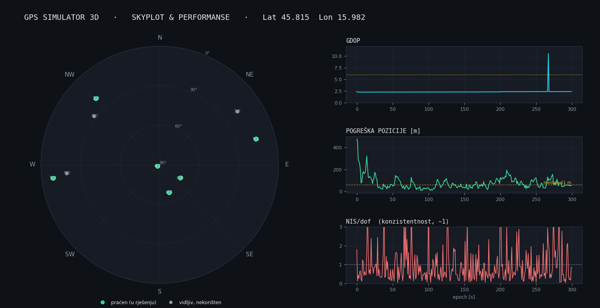
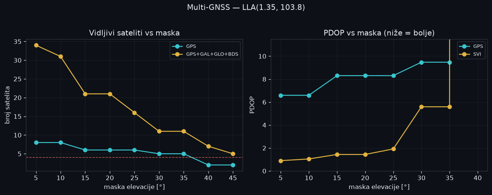
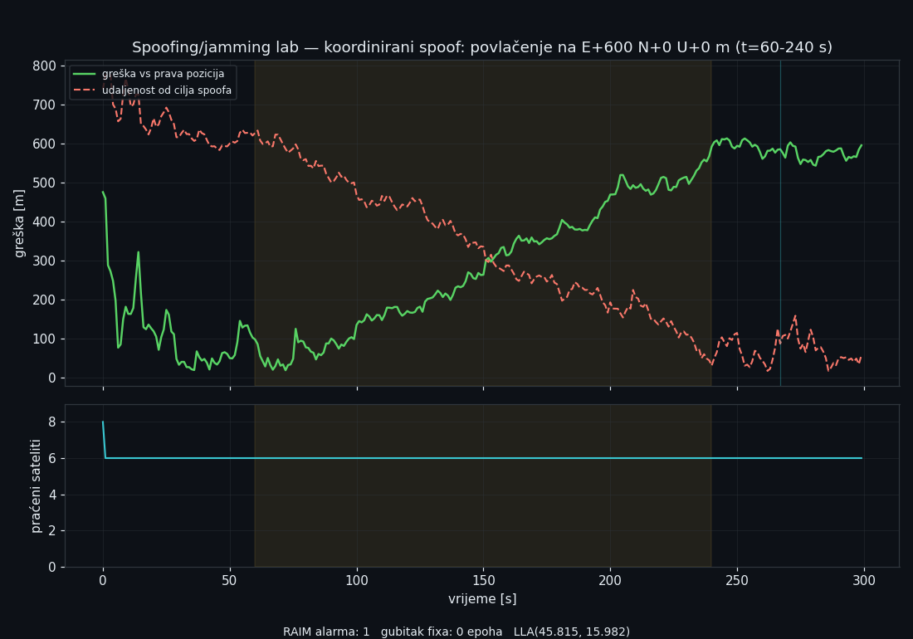
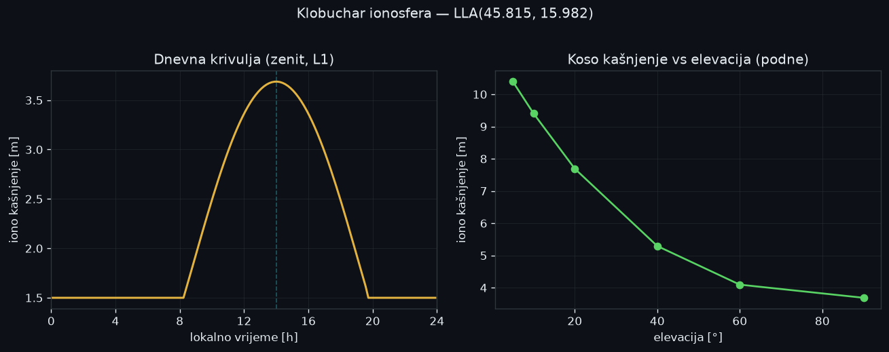
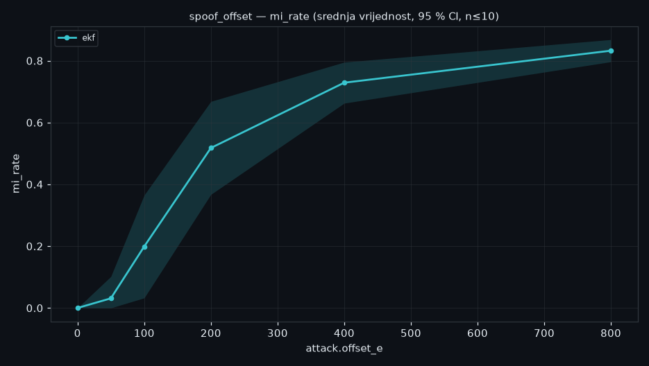

# GPS Simulator 3D

*[🇭🇷 Hrvatska verzija](README.md) · [Technical deep-dive](GPS_Simulator_Documentation.md) · [The Sagnac bug story](docs/sagnac-bug.md)*

A software-defined **GNSS simulator with a real navigation processor** — not a
toy that draws satellites, but a full signal-to-position pipeline whose core
would run on real measurements. Errors are injected at the **measurement** level
(ionosphere, troposphere, multipath, clocks, relativity, ephemeris) and solved
by **textbook GNSS algorithms**: least-squares cold start → **11-state Extended
Kalman Filter** (position/velocity/clock/drift + inter-system bias) →
**MAD-robust RAIM** → elevation-dependent measurement noise → NIS consistency
diagnostics.

A web **control center + GNSS academy** (FastAPI + CesiumJS, bilingual) over a
headless `numpy` engine — live 3D globe, telemetry, guided lessons, experiments.

> **What's real vs. simulated?** Everything *above the signal layer* is
> authentic — the solver is the same algorithm that would run on a real
> receiver. The RF layer is a semi-analytic correlator model: real C/A **Gold
> codes**, **C/N0 from a link budget**, coherent integration + relative Doppler
> (cross-correlation / near-far), jamming in the signal and DLL noise from C/N0
> (no sample-level signal or carrier-phase tracking in the code chain). See the
> [honest self-assessment](GPS_Simulator_Documentation.md#8-osvrt-i-analiza-iskreno).

---

## Highlights

- **Real navigation solver** — 11-D EKF + RAIM + iono-free dual-frequency (L1/L2)
  + inter-system bias estimation. Satellite selection uses the *estimated*
  position, never the truth ("the receiver may not know what it couldn't know").
- **Physics with depth** — Klobuchar ionosphere (time-of-day), Hopfield
  troposphere, Sagnac, eccentricity-dependent relativity, Allan-variance clocks,
  J2 orbital precession, real global DEM (NASA SRTM) with line-of-sight
  raycasting through terrain.
- **Spoofing / jamming lab** — attacks injected at the measurement level pass
  through the real EKF/RAIM. A *coordinated* spoof is not caught by RAIM — a
  correct, honest result that demonstrates a genuine vulnerability, not a bug.
- **Correlated-error realism** — L1/L2 multipath shares one reflection geometry
  (so iono-free no longer over-inflates it ~3×); ephemeris error is a
  slowly-varying Gauss-Markov process, not white noise.
- **Zero-noise consistency test** — turn every noise source off and the solution
  collapses to ~10 µm, proving every injected term is exactly cancelled by its
  correction (this is how the [Sagnac bug](docs/sagnac-bug.md) is now guarded).
- **Engineering hygiene** — 60 tests, CI on Python 3.11–3.13, a single seeded
  `Generator` threaded through every noise source (byte-reproducible), headless
  engine fully decoupled from the GUI.
- **Research sandbox** — declarative experiments from one JSON spec: parameter
  sweeps × Monte Carlo over seeds (noise *and* constellation geometry) × several
  estimators on the *same* measurements, 95 % confidence intervals, CSV/JSON/PNG
  export, plugin registries for estimators/attacks/metrics, parallel and
  bit-for-bit reproducible regardless of worker count.
- **Educational web layer** — live globe, click-to-place receiver, glossary
  popovers over live numbers, guided lessons that drive the app, bilingual HR/EN.

---

## Gallery

Headless analysis tools render figures directly from the engine:

| Skyplot + GDOP / error / NIS | Multi-GNSS availability + ISB |
|---|---|
|  |  |

| Spoofing / jamming lab | Klobuchar ionosphere (diurnal) |
|---|---|
|  |  |

> The web control center is interactive; run it locally to explore the live 3D
> globe (see below). *(Animated GIFs of the live UI to follow.)*

---

## Quickstart

Works on Windows, macOS and Linux (the engine is pure Python; only launchers and
paths differ).

```bash
python -m venv .venv
# Windows: .venv\Scripts\activate   |  Linux/macOS: source .venv/bin/activate
pip install -r requirements-dev.txt      # engine + tests
pip install -r requirements-plots.txt    # + matplotlib for CLI plot tools

python benchmark.py     # headless: EKF convergence + error statistics
python skyplot.py       # skyplot + GDOP/error/NIS plots  -> skyplot.png
python spoofing.py --attack coordinated --plot   # spoofing/jamming lab
python multignss.py     # GPS+GAL+GLO+BDS: availability / PDOP / ISB
pytest                  # 62 tests
```

One-command setup: **`setup.bat`** (Windows) or **`./setup.sh`** (macOS/Linux)
creates the venv and installs everything.

### Web control center + GNSS academy

Interactive 3D globe (CesiumJS), live simulation, click-to-place receiver,
telemetry, glossary and guided lessons — the existing engine driven live over a
FastAPI backend. Build once (needs Node 20.19+ or 22.12+), then run:

- **Windows:** `build_web.bat` → `run_webapp.bat`
- **macOS/Linux:** `./build_web.sh` → `./run_webapp.sh` (or `./gps.sh web`)

The browser opens automatically once the server is up. Details in
[`web/README.md`](web/README.md).

The live simulation also shows **integrity** (statistical RAIM: status, HPL/VPL and
a protection-level circle around the estimate) and **RTK** (toggle in the panel; the
base is placed automatically 4 km from the rover or with Shift + double-click; FIX
≈1 cm with GPS+Galileo+BeiDou).

**Real orbits** (panel → Orbits → Real): the actual GPS, Galileo, GLONASS and BeiDou satellites
(146, including BeiDou GEO/IGSO) for "now" or a chosen date, from CelesTrak GP elements
propagated with SGP4 (`real_orbits.py`). The simulation then runs in real UTC: Earth rotation
(GMST), the Sun on the globe and the ionosphere match the actual moment, so the skyplot matches
your phone. Fresh elements are downloaded only on "Refresh data" (12 h cache); offline, a
built-in snapshot is used (`data/gnss_gp_snapshot.json`, data: CelesTrak).

**Inside view** (button in the academy section) opens the math of one epoch: model and
innovation of every pseudorange with an error budget (that only the simulator knows),
the geometry matrix and DOPs, the Kalman step (predict → gain → update, each satellite's
contribution) and RAIM (T on the χ² curve, slopes, HPL). It can be frozen and stepped.

---

## Research sandbox

`sandbox.py` runs a whole **study** from one JSON spec: a parameter grid (sweep) ×
Monte Carlo over seeds (noise **and** constellation geometry via `t0_random_s`) ×
several algorithms fed the **same** measurements. For every sweep point it reports
mean, median, p95 and a **95 % confidence interval** across seeds, writes
`results.json` (spec + git commit + per-run and aggregated metrics) and
`results.csv`, and `--plot` draws the metric vs the swept parameter with a CI band.
Results are identical for any `--workers` count.

```bash
python sandbox.py list                                   # estimators / attacks / metrics / examples
python sandbox.py validate sandbox/examples/raim_roc.json
python sandbox.py run sandbox/examples/spoof_offset.json --workers 4 --out results/spoof --plot
```

```python
import sandbox
res = sandbox.run({"world": {"duration_s": 120, "t0_random_s": 86164}, "seeds": 8,
                   "attack": {"type": "sat_fault", "start": 30},
                   "sweep": {"attack.bias_m": [0, 15, 30, 60], "raim.pfa": [1e-3, 1e-5]},
                   "metrics": ["raim_pd", "mi_events", "h_err_p95"]}, workers=4)
res.table("raim_pd")          # numpy array of means per sweep point
```

**Plugins** without touching the engine: `@register_estimator("name")`
(`factory(world)` → object with `solve(signals, t) -> (pos_ecef | None, info)`),
`@register_attack("name")` (`apply(signals, t, rx_pos, rng)` + `is_active(t)`),
`@register_metric("name")` (`fn(trace) -> float`). Built in: `ekf` (the real
`receiver.Receiver` incl. RAIM), `wls` (snapshot WLS + snapshot RAIM with FDE), all
`spoofing.py` attacks + `sat_fault` (single-satellite clock fault) and ~40 metrics —
accuracy, availability, integrity availability (HPL ≤ HAL), P_D, false alarms,
time-to-detect, **misleading information** (error > HPL with no alarm), HMI,
NIS/dof, solver runtime. Example studies (RAIM ROC, spoof vs MI, jamming, multi-GNSS
vs mask, EKF vs WLS) live in [`sandbox/examples/`](sandbox/examples/README.md); the
web app has the same in Experiments → **Sandbox** (edit the spec, background job,
CI chart, CSV download).

| RAIM detection probability vs fault size | Coordinated spoof: misleading-information rate |
|---|---|
|  |  |

---

## How it works (one diagram)

```
Visible sats (elev > 5°, LOS through terrain)
      │
      ▼  DOP selection (10 best, greedy, from the ESTIMATE)
RF channel + FFT correlation (L1 & L2, 8× oversampled)
      │
      ▼  iono-free combination (cancels the ionosphere)
Measurement corrections (+ rx clock, − troposphere, + Sagnac, + ISB)
      │
      ▼  11-state EKF  →  RAIM (MAD outlier rejection)
Position + GDOP + NIS
```

Full architecture, block diagrams and model derivations:
[`GPS_Simulator_Documentation.md`](GPS_Simulator_Documentation.md).

---

## Repository map

| Module | Role |
|--------|------|
| `physics_engine.py` | Orbits (Kepler + J2), iono/tropo, relativity, clocks, slowly-varying ephemeris |
| `satellite.py` | Satellites + Walker-Delta and multi-GNSS (GPS/GAL/GLO/BDS) constellations |
| `signal_processing.py` | Real C/A **Gold codes**, correlated L1/L2 multipath, reference 8× FFT RF channel |
| `signal_model.py` | Signal model: **C/N0** link budget, jammer + cross-correlation (near-far), DLL bias/noise |
| `measurement.py` | Measurement model: channel + corrections + DOP selection → pseudoranges |
| `receiver.py` | Estimator: LS cold start → 11-D EKF → RAIM (owns the measurement model) |
| `raim.py` | Integrity: χ² residual test, fault exclusion (FDE), protection levels HPL/VPL |
| `terrain.py` | Global DEM (NASA SRTM) + bilinear interpolation |
| `utils.py` | Geodesy: LLA ↔ ECEF on the WGS-84 ellipsoid |
| `web/` | Web control center + GNSS academy (FastAPI + CesiumJS) — the 3D interface |
| `rinex.py` · `ephemeris.py` · `realdata.py` · `broadcast_constellation.py` | **Real data**: RINEX obs/nav (v2/v3) + SP3 parsers, IS-GPS-200 broadcast orbits, single-point positioning on real RINEX through the same EKF/RAIM, constellation driven by a real nav file |
| `rtk.py` · `spoofing.py` · `multignss.py` · `iono.py` · `skyplot.py` · `scenario.py` · `benchmark.py` | Standalone headless tools |
| `sandbox.py` · `sandbox/examples/` | Research sandbox: declarative sweep × Monte Carlo × estimator experiments, plugin registries |

---

## Textbook (Croatian)

**[⬇ Download the PDF](https://github.com/dodozg/gps-simulator-3d/releases/latest/download/Satelitska_navigacija_u_simulatoru.pdf)** (CC BY 4.0) · [edition without solutions](https://github.com/dodozg/gps-simulator-3d/releases/latest/download/Satelitska_navigacija_u_simulatoru_bez_rjesenja.pdf)

[`docs/udzbenik/`](docs/udzbenik/README.md) contains *Satelitska navigacija u simulatoru*, an
83-page Croatian GNSS textbook for engineering students with 67 exercises run in this
simulator (guided in the web app, pen-and-paper/Python, and sandbox research studies) and
worked solutions. Every number and figure is computed by the simulator with fixed seeds,
so the book is reproducible: `python docs/udzbenik/build.py --slike` (needs `typst`, `matplotlib`).

## Tests & reproducibility

`pytest` (config in `pyproject.toml`). Every noise source takes an explicit
`np.random.Generator` shared by the constellation and receiver, so results are
byte-reproducible without global state. CI runs the suite on Python 3.11–3.13.
A **zero-noise consistency test** guards against the whole class of
"truth leaking into the receiver" bugs — the class the
[Sagnac bug](docs/sagnac-bug.md) belonged to.

---

## License & data

Code: [MIT](LICENSE). Textbook (`docs/udzbenik/`): [CC BY 4.0](docs/udzbenik/LICENSE). Fonts: SIL OFL 1.1. RINEX/SP3 test data: BSD-2 (RTKLIB).
Terrain (`terrain_dem.npz`) is derived from NASA SRTM RAMP2 (public domain).
