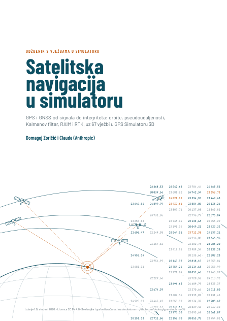
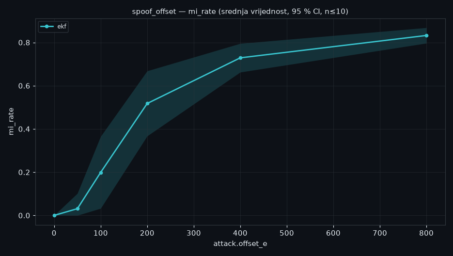

# GPS Simulator 3D

[](https://doi.org/10.5281/zenodo.24406780)

<table><tr>
<td width="190"><a href="https://github.com/dodozg/gps-simulator-3d/releases/latest/download/Satelitska_navigacija_u_simulatoru.pdf"></a></td>
<td>

### 📘 Udžbenik: *Satelitska navigacija u simulatoru*

Besplatan udžbenik na hrvatskom (83 str., 67 vježbi s rješenjima) za studente tehnike i inženjere:
od signala i orbita do Kalmanovog filtra, RAIM-a, RTK-a i napada na GNSS, uz vježbe u ovom simulatoru.

**[⬇ Preuzmi PDF](https://github.com/dodozg/gps-simulator-3d/releases/latest/download/Satelitska_navigacija_u_simulatoru.pdf)** ·
[izdanje bez rješenja (za zadaće)](https://github.com/dodozg/gps-simulator-3d/releases/latest/download/Satelitska_navigacija_u_simulatoru_bez_rjesenja.pdf) ·
[izvori i izgradnja](docs/udzbenik/README.md) · licenca CC BY 4.0

</td></tr></table>

*[🇬🇧 English version](README.en.md) · [Tehnička dokumentacija](GPS_Simulator_Documentation.md) · [Priča o Sagnac bugu](docs/sagnac-bug.md)*

Simulator satelitske navigacije u Pythonu: Walker-Delta konstelacija, eliptične
orbite (Kepler + J2), fizička obrada signala (PRN + FFT korelacija, multipath,
AWGN), dual-frequency iono-free kombinacija te navigacijski procesor s Extended
Kalman filterom i RAIM zaštitom. 3D prikaz i živa simulacija su u web kontrolnom
centru (CesiumJS + FastAPI).

Za detaljan opis algoritama vidi [`GPS_Simulator_Documentation.md`](GPS_Simulator_Documentation.md);
za priču o dijagnostici Sagnac buga (ENU dekompozicija → zero-noise test) vidi
[`docs/sagnac-bug.md`](docs/sagnac-bug.md).

## Struktura

| Modul | Uloga |
|-------|-------|
| `physics_engine.py`   | Orbite, atmosfera (iono/tropo), relativnost, modeli satova |
| `terrain.py`          | Pravi globalni DEM (NASA SRTM) + bilinearna interpolacija visina |
| `satellite.py`        | Walker-Delta konstelacija i satelitski satovi |
| `signal_processing.py`| Pravi C/A Gold kodovi, multipath, referentni FFT RF kanal |
| `signal_model.py`     | Signalni model: C/N0 iz link budgeta, ometač + cross-korelacija (near-far), DLL šum |
| `receiver.py`         | Estimator: LS inicijalizacija + EKF + RAIM (vlasi mjerni model) |
| `utils.py`            | Geodezija: LLA ↔ ECEF na WGS-84 elipsoidu, DMS format |
| `measurement.py`      | Mjerni model: kanal + korekcije + DOP selekcija → pseudoudaljenosti |
| `web/`                | Web kontrolni centar + GPS učilište (FastAPI + CesiumJS) — 3D prikaz |
| `benchmark.py`        | Headless pokretanje scenarija i statistika greške |
| `skyplot.py`          | Headless skyplot + grafovi GDOP/greška/NIS (PNG) |
| `rtk.py`              | Carrier-phase RTK (cm-precizno, double differencing, LAMBDA) — offline i živo u webu |
| `raim.py`             | Integritet: χ² test reziduala, isključivanje kvara (FDE), zaštitne granice HPL/VPL |
| `spoofing.py`         | Spoofing/jamming lab: napadi kroz pravi EKF/RAIM (headless) |
| `iono.py`             | Klobuchar ionosferska analiza (dnevna krivulja TEC-a) |
| `multignss.py`        | Multi-GNSS (GPS/GAL/GLO/BDS) + procjena inter-system biasa |
| `scenario.py`         | Snimanje/reprodukcija scenarija (JSON) + usporedba algoritama |
| `rinex.py`            | Parseri PRAVIH podataka: RINEX opažanja v2/v3, GPS navigacija v2/v3, SP3 |
| `ephemeris.py`        | IS-GPS-200 broadcast efemeride → ECEF pozicija i sat satelita |
| `realdata.py`         | SPP na pravim RINEX podacima kroz isti EKF/RAIM (CLI + `/api/realdata`) |
| `broadcast_constellation.py` | Konstelacija iz prave nav datoteke (isto sučelje kao Walker-Delta) |
| `sandbox.py`          | **Istraživački sandbox**: sweep × Monte Carlo × algoritmi iz JSON speca, plugini, CI, CSV/PNG |

Cijeli engine radi bez GUI-ja, pa se testira i mjeri na CI-ju (3D prikaz je u `web/`).

Teren je stvarni globalni DEM (`terrain_dem.npz`, izveden iz NASA SRTM RAMP2,
javna domena) — oceani na razini mora, planine na pravim mjestima. Datoteka je
uključena; `fetch_terrain.py` je regenerira/finije (`--width`).

`spoofing.py` je laboratorij napada koji se ubrizgavaju na razinu mjerenja pa
prolaze kroz pravi EKF/RAIM: **koordinirani spoof** (konzistentna lažna mjerenja
tiho odvuku poziciju — RAIM ne alarmira, temeljno ograničenje), **naivni
multi-SV** (nezavisni pomaci — robusni RAIM ih izolira), **meaconing** (uniformno
kašnjenje — upije se u sat prijemnika), **jamming** (ometač u SIGNALU: podiže
šumni pod, C/N0 pada, sateliti gube zabravu, preživjeli su bučniji — i gubi se
fix, bez lažnih RAIM alarma jer prijemnik težini po C/N0). `--plot` crta grešku/RAIM/satelite kroz vrijeme.

Ionosfera je pravi **Klobuchar model** (`physics_engine.klobuchar_delay`), ovisan
o dobu dana (vrh TEC-a ~14:00 lokalno, noćni pod) i geometriji. Prijemnik injektira
kašnjenje na L1/L2 pa ga iono-free kombinacija poništava; `iono.py` crta dnevnu
krivulju i ovisnost o elevaciji.

`multignss.py` kombinira **GPS + Galileo + GLONASS + BeiDou** (`MultiGNSSConstellation`).
Svaki sustav unosi konstantni **inter-system bias** (različite vremenske skale) koji
prijemnik procjenjuje kao dodatno stanje uz položaj i vlastiti sat. Više satelita =
niži PDOP i fix i tamo gdje GPS sam vidi < 4 satelita (npr. maska 30° = urbani kanjon).

`scenario.py` sprema cijeli scenarij (lokacija/vrijeme/kvar/seed) u **JSON** pa je
reprodukcija deterministička (bajt-identične metrike). `run` odvrti scenarij,
`compare` uspoređuje algoritme (RAIM on/off) ili dva scenarija, `record` snima novi.
Bundlani primjeri su u `scenarios/` (vedro, teren, koordinirani/naivni spoof).

## Instalacija

Radi na Windowsu, macOS-u i Linuxu (engine je čisti Python; razlikuju se samo
launcheri i putanje).

- **Windows:** dvoklik **`setup.bat`** — kreira svjež `.venv` i instalira
  ovisnosti (web + alati + testovi).
- **macOS / Linux:** **`./setup.sh`** — isto. Prije toga možda `chmod +x *.sh`.

Ručno (bilo koji OS):

```bash
python -m venv .venv
# Windows: .venv\Scripts\activate     |  Linux/macOS: source .venv/bin/activate

pip install -r requirements-dev.txt    # engine + testovi
pip install -r requirements-plots.txt  # + matplotlib za CLI alate (skyplot/iono/…)
pip install -r requirements-web.txt    # + web kontrolni centar (uključuje plots)
```

Launcheri (`run_*.bat` na Windowsu; `./gps.sh <alat>` na macOS/Linux) prvo probaju
venv python, a ako on ne radi padaju na sistemski Python + `PYTHONPATH` na `.venv`
pakete.

> **Napomena o `.venv` na Google Driveu:** jedan `.venv` ne može posluživati i
> Windows (`Scripts\`, `.exe`) i Mac (`bin/`) — layout je različit. `.venv` je
> gitigniran; na svakom stroju ga kreiraj nanovo (`setup.bat` / `./setup.sh`).

## Pokretanje

Na macOS/Linux svi alati idu kroz jedinstveni launcher **`./gps.sh <alat>`**
(npr. `./gps.sh benchmark --seconds 300`, `./gps.sh scenario list`). Na Windowsu
postoje ekvivalentni `run_*.bat` (dvoklik). Izravno kroz Python (bilo koji OS):

```bash
python benchmark.py     # headless: konvergencija EKF-a i statistika greške
python skyplot.py       # skyplot + GDOP/greška/NIS grafovi -> skyplot.png
python rtk.py           # carrier-phase RTK demo (cm-precizno)
python spoofing.py --attack coordinated --plot   # spoofing/jamming lab -> spoofing.png
python iono.py          # Klobuchar dnevna ionosfera -> iono.png
python multignss.py     # GPS+GAL+GLO+BDS: dostupnost/PDOP/ISB -> multignss.png
python scenario.py list                                  # bundlani JSON scenariji
python scenario.py compare scenarios/jamming_naive_spoof.json   # RAIM on vs off
python sandbox.py run sandbox/examples/raim_roc.json --workers 4 --plot   # istraživačka studija
pytest                  # test suite
```

Interaktivni 3D prikaz (globus, klik-postavljanje prijemnika, telemetrija, živa
simulacija) je u **web kontrolnom centru** — vidi niže i [`web/README.md`](web/README.md).

**Pravi podaci.** `realdata.py` čita stvarna RINEX opažanja (v2.1x/v3.0x) i GPS
navigacijsku datoteku, računa pozicije satelita iz broadcast efemerida
(`ephemeris.py`, IS-GPS-200), korigira sat satelita, Klobuchar ionosferu i
troposferu te mjerenja predaje ISTOM `Receiver` EKF-u/RAIM-u. Uzorak (RTKLIB test
data, BSD-2; GEONET stanica 0759, 1 h) je u `tests/data/`:
`python realdata.py tests/data/07590920.05o tests/data/07590920.05n --plot` →
greška vs. koordinata stanice (horizontalno medijan ~0.4 m, 95% ~0.8 m).
`BroadcastConstellation` daje STVARNE položaje satelita za odabrani datum (upute
za spajanje u živu sesiju su u zaglavlju `broadcast_constellation.py`).

## Istraživački sandbox

`sandbox.py` vrti cijelu **studiju** iz jednog JSON speca: rešetku parametara
(sweep) × Monte Carlo preko sjemena (šum **i** geometrija konstelacije) × više
algoritama na **istim** mjerenjima. Za svaku točku sweepa daje srednju vrijednost,
medijan, p95 i **95 % interval pouzdanosti** preko sjemena, sprema
`results.json` (spec + git commit + metrike po runu i agregat) i `results.csv`, a
`--plot` crta metriku vs parametar s CI vrpcom. Rezultat je identičan neovisno o
broju procesa (`--workers`).

```bash
python sandbox.py list                                   # estimatori / napadi / metrike / primjeri
python sandbox.py validate sandbox/examples/raim_roc.json
python sandbox.py run sandbox/examples/spoof_offset.json --workers 4 --out results/spoof --plot
```

```python
import sandbox
res = sandbox.run({"world": {"duration_s": 120, "t0_random_s": 86164}, "seeds": 8,
                   "attack": {"type": "sat_fault", "start": 30},
                   "sweep": {"attack.bias_m": [0, 15, 30, 60], "raim.pfa": [1e-3, 1e-5]},
                   "metrics": ["raim_pd", "mi_events", "h_err_p95"]}, workers=4)
res.table("raim_pd")          # numpy niz srednjih vrijednosti po točki sweepa
```

**Plugini** bez diranja enginea: `@register_estimator("ime")` (`factory(world)` →
objekt s `solve(signals, t) -> (pos_ecef | None, info)`), `@register_attack("ime")`
(`apply(signals, t, rx_pos, rng)` + `is_active(t)`), `@register_metric("ime")`
(`fn(trace) -> float`). Ugrađeni su `ekf` (pravi `receiver.Receiver` s RAIM-om),
`wls` (snapshot WLS + snapshot RAIM s FDE-om), svi napadi iz `spoofing.py` + `sat_fault`
(kvar sata jednog satelita) i ~40 metrika — točnost, dostupnost, dostupnost
integriteta (HPL ≤ HAL), P_D, lažni alarmi, vrijeme do detekcije, **misleading
information** (greška > HPL bez alarma), HMI, NIS/dof, vrijeme solvera.
Primjeri studija (ROC RAIM-a, spoof vs MI, jamming, multi-GNSS vs maska, EKF vs
WLS) su u [`sandbox/examples/`](sandbox/examples/README.md); isto je dostupno u
webu (Eksperimenti → **Sandbox**: uređivanje speca, pozadinski job, graf s CI, CSV).



## Web kontrolni centar + GPS učilište

Moderno web sučelje (3D globus na CesiumJS, živa simulacija, telemetrija i
edukativni pojmovnik na klik, dvojezično HR/EN) koje postojeći numpy engine
koristi izravno preko FastAPI backenda. Jednom (traži Node 20.19+ ili 22.12+) pa pokreni:
**Windows** `build_web.bat` → `run_webapp.bat`; **macOS/Linux** `./build_web.sh`
→ `./run_webapp.sh` (ili kraće `./gps.sh web`). Detalji u
[`web/README.md`](web/README.md).

U živoj simulaciji su i **integritet** (statistički RAIM: status, HPL/VPL i krug
zaštitne granice oko procjene) te **RTK** (prekidač u panelu; baza se postavlja
sama 4 km od rovera ili Shift + dvoklikom na globus; FIX ~1 cm uz GPS+Galileo+BeiDou).

**Prave orbite** (panel → Orbite → Prave): stvarni GPS, Galileo, GLONASS i BeiDou sateliti
(146, uključujući BeiDou GEO/IGSO) za "sada" ili odabrani datum, iz CelesTrak GP elemenata
propagiranih SGP4-om (`real_orbits.py`). Simulacija tada teče u pravom UTC-u: rotacija Zemlje
(GMST), Sunce na globusu i ionosfera odgovaraju stvarnom trenutku, pa se skyplot poklapa s
mobitelom. Svježi elementi se skidaju samo na klik "Osvježi podatke" (cache 12 h); bez
interneta se koristi ugrađena snimka (`data/gnss_gp_snapshot.json`, podaci: CelesTrak).

**Pogled iznutra** (gumb u učilištu) otvara matematiku jedne epohe: model i inovacija
svake pseudoudaljenosti s proračunom greške (koji zna samo simulator), matrica
geometrije i DOP-ovi, Kalmanov korak (predikcija → pojačanje → ažuriranje, doprinos
svakog satelita) i RAIM (T na krivulji χ², nagibi, HPL). Može se zamrznuti i ići korak po korak.

## Udžbenik

**Satelitska navigacija u simulatoru** — udžbenik na hrvatskom (PDF, 83 str.) za studente
tehnike: od signala i orbita preko najmanjih kvadrata, DOP-a i Kalmanovog filtra do
RAIM-a, RTK-a, ometanja/lažiranja i pravih RINEX podataka, sa 67 vježbi u ovom
simulatoru (vođene u aplikaciji, računske, istraživačke u sandboxu) i rješenjima.
Sve brojke i grafovi u knjizi izračunati su ovim simulatorom (fiksna sjemena), pa se
knjiga reproducira: [`docs/udzbenik/`](docs/udzbenik/README.md).

```bash
pip install typst matplotlib
python docs/udzbenik/build.py            # PDF iz postojećih slika
python docs/udzbenik/build.py --slike    # najprije ponovno izračunaj sve slike i brojke
```

## Testovi

Testovi su u `tests/` i pokreću se s `pytest` (konfiguracija u `pyproject.toml`).
Svi izvori šuma primaju eksplicitni `np.random.Generator` koji konstelacija i
prijemnik dijele (`np.random.default_rng(seed)`), pa su rezultati reproducibilni
bez oslanjanja na globalno stanje. CI (`.github/workflows/ci.yml`) vrti suite na
Pythonu 3.11–3.13.

## Citiranje

Zoričić, D. i Claude (Anthropic) (2026). *GPS Simulator 3D i udžbenik „Satelitska navigacija u simulatoru”*.
Zenodo. https://doi.org/10.5281/zenodo.24406780

DOI iznad uvijek vodi na najnovije izdanje; svako izdanje ima i vlastiti DOI na Zenodu.
GitHub nudi i gumb „Cite this repository” (iz `CITATION.cff`).

## Licenca

Kod: [MIT](LICENSE). Udžbenik (`docs/udzbenik/`): [CC BY 4.0](docs/udzbenik/LICENSE), slobodno ga dijeli,
tiskaj i prilagođavaj uz navođenje autora. Fontovi: SIL OFL 1.1. Testni RINEX/SP3 podaci: BSD-2 (RTKLIB).
